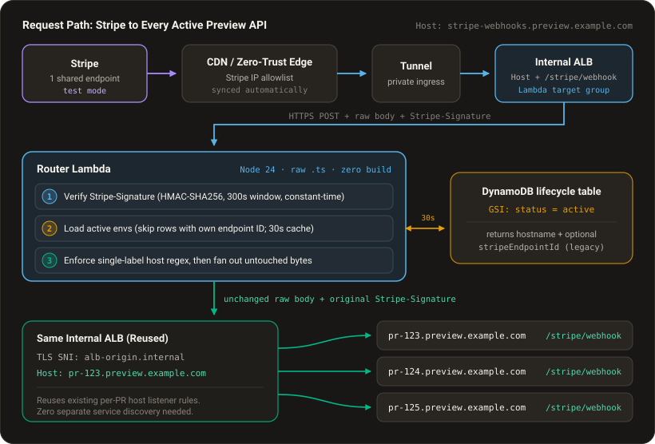

A lot of preview infrastructure assumes human concurrency. Fixed vendor quotas, per-branch third-party registrations, and cleanup scripts all hold up fine when everyone opens one pull request at a time and six or eight environments are alive at once.

Coding agents break those assumptions fast.

At work, most engineers now run multiple agent sessions in parallel all day. Agents open branches, spin up full ephemeral preview environments (each with its own API, database, and URL like `pr-123.preview.example.com`), run real flows against them, and throw branches away when an approach misses. Twenty concurrent preview environments is just a normal Tuesday now.

Whenever every PR has to register and tear down a finite resource inside a shared vendor account just to boot, agent cadence walks straight into the ceiling. The first wall we hit was Stripe test mode. Our preview platform allowed 20 concurrent environments, Stripe caps a test-mode account at 16 webhook endpoints, and environment creates started failing at number 16 with zero leaks.

## Sixteen Endpoints Was Sixteen Copies of the Same Stream

Our old environment creation script registered a fresh Stripe webhook endpoint for every PR (`https://pr-123.preview.example.com/stripe/webhook`), stored that endpoint's signing secret on the branch, and deleted the endpoint on teardown.

Before we ever hit 16 real environments, cancelled runs and half-failed creates left orphaned endpoints behind. Agent workflows made that churn much worse because branches get opened, tested, abandoned, and recreated constantly. We added a prune-on-create sweep to clear dead endpoints before creating a new one, which helped with leaks, until 16 active PRs showed up at once and an agent loop stalled waiting for endpoint 17.

What made the fix obvious was remembering how Stripe test-mode webhooks actually work. Every endpoint receives **every** event in the account. When `pr-123` triggered a checkout, `pr-123` received the webhook, and so did `pr-124`, `pr-125`, and every other preview environment running at that moment. Each API was already reading the full firehose and ignoring records outside its own database.

> Every preview environment was already getting every other PR's billing events. We were just asking Stripe to push the same stream 16 times.

So we stopped creating endpoints per PR. One shared test-mode endpoint points at a small router Lambda we own, and the router fans events out to active environments.


## Routing Behind the Load Balancer We Already Had

An operator creates the single Stripe endpoint once, pointed at a fixed hostname like `stripe-webhooks.preview.example.com`. Inbound events hit our CDN and zero-trust edge (where an IP allowlist stays synced with Stripe's published webhook IPs), go over the tunnel to our internal ALB, match a host-header listener rule, and invoke the router Lambda target group.



The router verifies `Stripe-Signature` itself (`t=...`, `v1=...`, HMAC-SHA256 over `` `${t}.${rawBody}` ``, 300-second window, constant-time compare with `crypto.timingSafeEqual`). Invalid requests get a `400` right away. Valid requests get forwarded downstream with the **unchanged raw body** and the **original `Stripe-Signature` header**. Every preview environment shares that endpoint's signing secret, so the application code keeps verifying webhooks the exact same way with zero changes.

To reach each environment, the router posts straight back into the same internal ALB with TLS SNI set to the ALB's origin hostname and the HTTP `Host` header set to `pr-123.preview.example.com`. That reuses all of our existing per-environment listener rules instead of building a second service-discovery layer.

Target environments come from a DynamoDB `lifecycle` table (a GSI on `status = active`, cached in memory for about 30 seconds). Before sending anything, the router checks that every hostname matches a single DNS label under the preview domain (`^[a-z0-9-]+\.preview\.example\.com$`) so a bad table row can never turn the router into an open internal proxy.

## The Router Code

Modeling the router with [Effect](https://effect.website/) (v4) makes the error boundaries, timeouts, and retry rules explicit in one place. I/O dependencies live behind a `Context.Service`, so unit tests supply in-memory fakes and `TestClock` without mocking AWS:

```ts
import { Clock, Context, Effect } from "effect";

const PREVIEW_HOST = /^[a-z0-9-]+\.preview\.example\.com$/;
const RETRYABLE_STATUS = new Set([502, 503, 504]);

class RouterDeps extends Context.Service<
  RouterDeps,
  RouterServices
>()("RouterDeps") {}

const deliverToEnv = (
  send: RouterServices["send"],
  host: string,
  rawBody: string,
  sig: string,
) =>
  send({ host, rawBody, sig }).pipe(
    Effect.timeout("4 seconds"),
    Effect.retry({
      times: 1,
      while: (err) =>
        err._tag === "ConnectionError" ||
        (err._tag === "HttpError" && RETRYABLE_STATUS.has(err.status)),
    }),
    Effect.timeout("8 seconds"),
    Effect.as(true),
    Effect.catch(() => Effect.succeed(false)),
  );

export const routeWebhook = (event: AlbEvent) =>
  Effect.gen(function* () {
    const deps = yield* RouterDeps;
    const secret = yield* deps.fetchSecret;
    if (!secret || secret === "PLACEHOLDER") {
      return { statusCode: 503, body: "router secret not seeded" };
    }

    const rawBody = event.isBase64Encoded
      ? Buffer.from(event.body ?? "", "base64").toString("utf8")
      : (event.body ?? "");
    const sig = event.headers?.["stripe-signature"];
    const now = yield* Clock.currentTimeMillis;

    if (!sig || !verifyStripeSignature(rawBody, sig, secret, now)) {
      return { statusCode: 400, body: "invalid signature" };
    }

    const targets = yield* deps.listTargets.pipe(
      Effect.mapError(() => ({ _tag: "DiscoveryFailed" as const })),
    );
    const active = targets.filter(
      (t) => !t.stripeEndpointId && PREVIEW_HOST.test(t.host),
    );

    const results = yield* Effect.forEach(
      active,
      (t) => deliverToEnv(deps.send, t.host, rawBody, sig),
      { concurrency: "unbounded" },
    );

    emitEmfMetrics(results);
    return { statusCode: 200, body: "ok" };
  }).pipe(
    Effect.catchTag("DiscoveryFailed", () =>
      Effect.succeed({ statusCode: 500, body: "target discovery failed" }),
    ),
  );
```

## Return 200 Always, and Never Retry a Timeout

If a downstream preview environment returns `500`, propagating that `500` back to Stripe is a trap. Stripe will retry the webhook against the router, which fans it out to **every** active environment again. With 15 or 20 human and agent branches running at the same time, several of them are always mid-iteration or legitimately returning `500` on events for subscriptions they don't own. One broken PR should never cause duplicate deliveries across nineteen healthy ones.


So gate errors answer Stripe directly (`503` if the signing secret is still a placeholder, `400` on bad signature, `500` if DynamoDB fails so Stripe retries the router). Once fan-out starts, the router always returns `200`.

Each delivery attempt gets a 4-second timeout inside an 8-second total budget, leaving headroom below Stripe's ~10-second expectation. We retry once on connection errors and `502`/`503`/`504`, and **never retry a timeout**.

Our first draft retried timeouts, and code review caught it. A connection error or `502` means the app never saw the request, while a timeout means it might still be midway through handling it and a retry could double-apply the event. We locked that behavior down with a test that points the router at a fake HTTP server that accepts the request and hangs forever, then asserts it received one `POST`.

If an environment is down when an event arrives, it misses that event. For test mode, replaying from the Stripe dashboard when you actually care is an easy tradeoff that avoids maintaining a queue. For observability, each invocation writes one CloudWatch EMF JSON line (`targets`, `delivered`, `failed`) to stdout instead of pulling in a metrics client.

## Check Ownership Before Side Effects

Fanning out one test account to 15 or 20 active preview environments exposed a real app bug fast.

An admin path ("force tier") called the Stripe API to update a subscription *before* checking whether that organization existed in the environment's local database. Under fan-out, every active PR environment saw the event and fired off the same Stripe mutation against the same shared subscription.

We fixed it by querying local DB ownership first, logging and returning early if the org isn't there, and adding a regression test asserting zero Stripe API calls happen for an unknown org. In any shared-account fan-out setup, idempotency alone isn't enough if unrelated environments can trigger outbound API mutations.

## Rolling Out Without Breaking Open PRs

To migrate while engineers and agents had live preview environments running, we let old and new environments coexist while open PRs drained. Legacy rows in the `lifecycle` table still carry their own `stripeEndpointId`, so the router skips them and never double-delivers. Per-branch secret overrides keep beating the shared secret, and publishing the shared secret to new environments is gated behind a separate flag because consumers fail closed on placeholder values.

The rollout took five steps (with rollback being a revert of step 5):

1. Create the secret shell (placeholder value) and config keys.
2. Deploy the router Lambda. Until seeded, it returns `503`.
3. Run a small idempotent operator CLI to create the shared Stripe endpoint and seed its signing secret. The CLI refuses `sk_live_` keys and looks up an existing endpoint by metadata so re-runs never duplicate it.
4. Flip the flag to publish the seeded shared secret to new environments.
5. Ship the platform change that stops creating per-environment Stripe endpoints.

Before step 4, we ran `stripe trigger customer.subscription.updated` with the test key and tailed the router logs. Legacy environments showed up as skipped (`own_endpoint`), and our single new-style environment returned `400` because it didn't have the shared secret yet. That `400` proved the whole path from edge to ALB to container worked.

After step 5 settled, the per-environment create and prune code had no callers, so we deleted ~800 lines of it. Teardown stays until the last legacy PR closes.

## Implementation Notes and Infra Gotchas

- **Zero-build TypeScript on Lambda.** Node 24 strips types natively, so you can zip raw `.ts` files behind a one-line `lambda.mjs` (`export { handler } from "./src/index.ts";`), enable `erasableSyntaxOnly` and `.ts` import paths in `tsconfig.json`, and rely on the runtime's bundled AWS SDK instead of bundling it yourself. We verified the exact zip locally against the official Lambda Node 24 base image and the Runtime Interface Emulator (RIE).
- **Deterministic zips and file modes.** Sort zip entries, pin timestamps, and force `0644` permissions so Terraform doesn't diff every plan and Lambda can actually read the files (we hit a bug where files got zipped as `0600`).
- **Cross-stack bootstrap order.** The router's Terraform root reads config keys created by the main platform apply, so CI plans failed until the router target was enabled after that apply.
- **CI plan bucket allowlists.** Our saved-plan artifact bucket had a per-target prefix allowlist. Adding a new Terraform target meant `terraform plan` passed and uploading the plan got an explicit deny.
- **Account Lambda concurrency.** Fresh AWS accounts default to a concurrency quota of 10, shared across every Lambda in the account. Another human-speed default worth bumping before you need it.
- **Empty inline security group ingress.** Keep the security group module's inline ingress list empty so other stacks can attach rules additively instead of overwriting each other.
- **Distinct endpoint metadata.** Tag the shared Stripe endpoint with its own `managed_by` value (like `managed_by=webhook-router`) so legacy cleanup and prune logic can never touch it.

## Stop Registering Shared Vendor State Per PR

Stripe's 16-endpoint limit was just the first place agent-paced concurrency caught up with our preview stack. The pattern generalizes to any boot step that registers a per-branch webhook, OAuth client, or sandbox resource inside a shared vendor account.

You can't prune your way past a hard quota when 20 parallel branches are genuinely alive. Pulling the fan-out behind the load balancer you already run removed ~800 lines of endpoint juggling, exposed a real billing ownership bug, and took the cap off the table for good.
