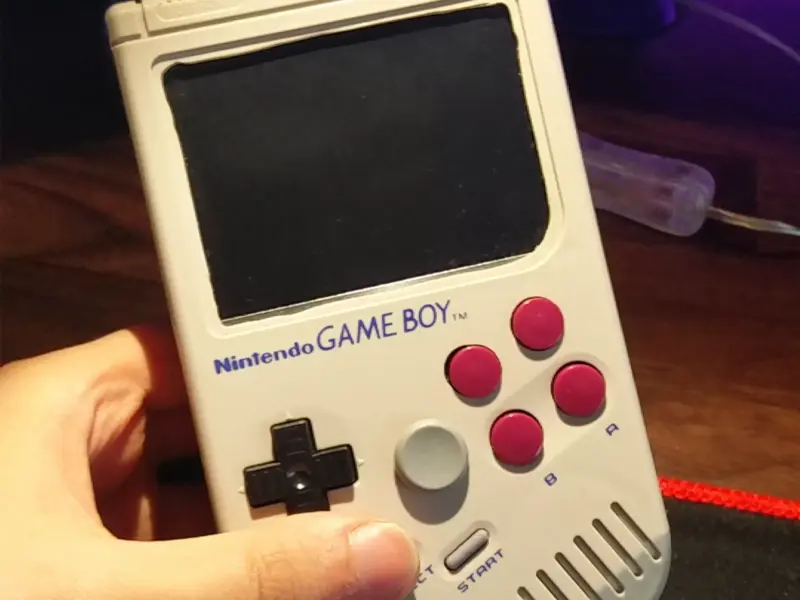
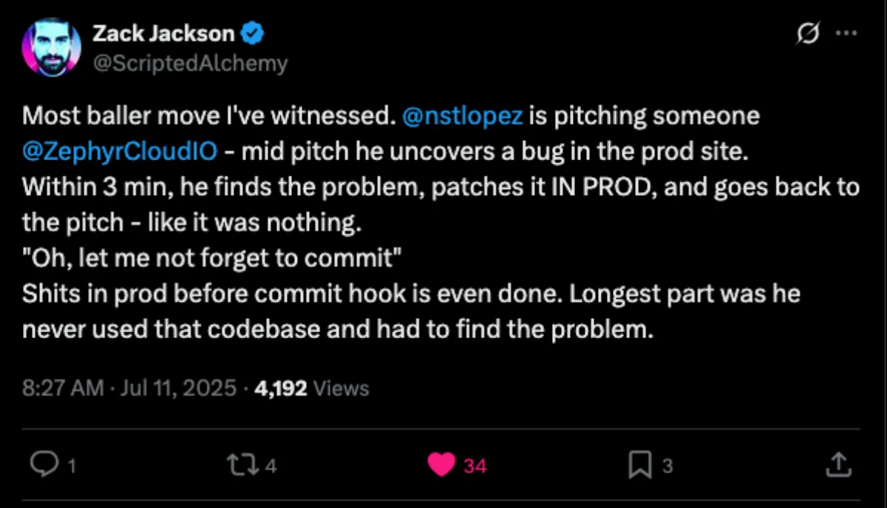
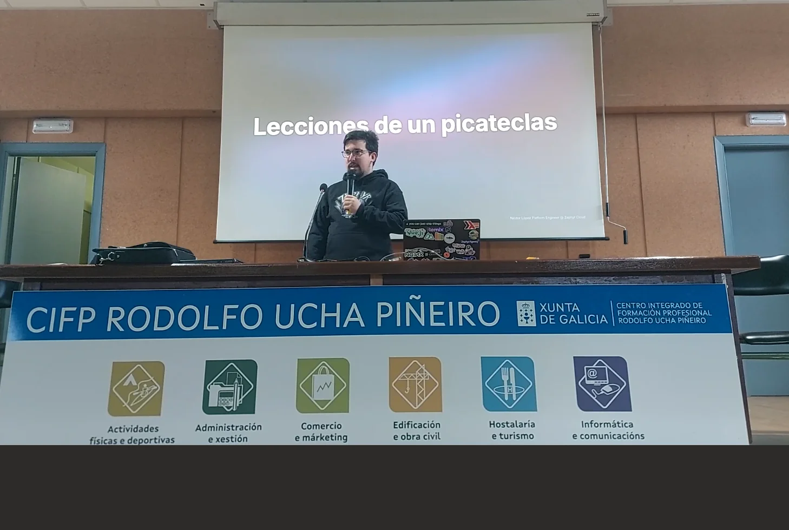
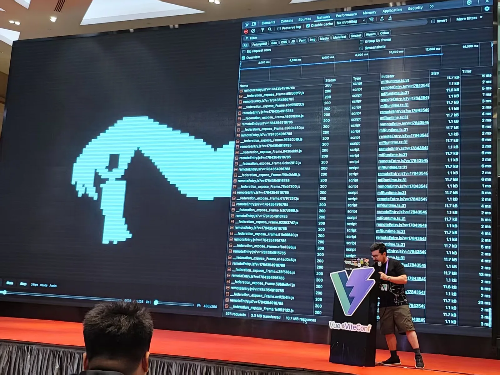

There are two photos on this site taken about ten years apart.

In the first one, from around 2016, I'm holding a [Game Boy with a Raspberry Pi Zero stuffed inside](/projects/gameboy/). In the second, from July 2026, I'm on stage at ViteConf Shanghai while [Bad Apple plays through 5,258 microfrontends](/projects/bad-apple-module-federation/) on a screen a few times taller than I am.

Looking at them side by side, the easy conclusion is that I just got a lot better at building things. Honestly, I don't think that's true. The Game Boy was already pretty ridiculous in its own right.

What actually changed is that I stopped keeping everything to myself. In 2016 I finished the Game Boy, uploaded a few photos to an imgur gallery, and moved on. In 2026 I put a silly demo on a screen in front of a room full of people. Between those two moments there was an internship, three jobs, starting my own company, around twenty talks, and two months bouncing around the United States. Looking back, most of the good things that happened didn't come from the building itself. They came from actually showing it to people.

## 2016: The Game Boy

The Game Boy came out in 1989 and the Raspberry Pi Zero came out in late 2015. Sometime in 2016 I crammed one into the other, running RetroPie, with three USB ports and a 3DS stick mounted in the middle of the shell.

My favorite part is still the cartridge. I wired the SD card slot into the original cartridge reader so the SD card sits inside an actual Game Boy cartridge. There's zero practical reason for that, I just thought it looked right.

And then I threw the photos into an imgur gallery and called it a day. No repo, no write-up, nobody to really share it with. I was happy I pulled it off, and then it just sat in a drawer.

## School and building for someone else

From 2018 to 2020 I studied systems and networks at a vocational school in Galicia called CIFP Rodolfo Ucha (keep that name in mind, it comes back later). After that I did a two-year game development program with Unity and C#.

On the side, I was building the standard junior portfolio: a React todo list, a Netflix clone, an Instagram clone. A Netflix clone isn't exactly thrilling engineering, sure, but it's something a hiring manager can glance at and immediately understand. Up until then I'd only built things for myself, so thinking about what another person might actually care about was new to me.

The projects from that stretch that I'm still fond of are the ones that had a real reason to exist:

- a [score analyzer](/projects/scores/) for Black Desert Online, because people were tracking war scores for 100+ players by hand in spreadsheets
- [nst.sh](/projects/nst_sh/), a URL shortener, because I once had to read an IP address and a port out loud to a friend at a party so he could open one of my apps
- a [covid tracker in Vue](/projects/covid/), mostly because every job listing in my city kept asking for Vue

That last one says a lot about where my head was at. Even if the audience was just local job postings, I was finally building with someone else in mind.

It worked well enough. In October 2020 I landed an internship at Hospital Arquitecto Marcide, building a React log viewer for the Galician public health service and deploying camera infrastructure on Docker Swarm. A few months later, in April 2021, I published the first post on this blog. All it said was "nothing to see here", and then in italics, "for now".

## NEXIONA and going quiet

In September 2021 I joined NEXIONA, an industrial IoT company, as a frontend engineer. By January 2023 I was lead architect, working with three teams and about fifteen engineers. One of the things I got to do there was migrate the builds from Webpack 3 to Vite, which should give you a pretty good idea of how old that codebase was.

(I also enrolled in a web development diploma in 2021 and finally finished it in 2025, four years into already being paid to do web development.)

On a CV, that stretch looks great. In reality, I'd gone completely dark outside of work.

In June 2023 I wrote [a post about my GitHub contribution graph](/blog/reflections-on-a-github-contribution-graph/) because it had gone totally empty. Every bit of energy was going into the day job. In that same post I wrote about impostor syndrome and feeling like a tiny fish whenever I was around people I admired. Back in 2016 I had a cool project and no audience; in 2023 I had a title and a team, and nothing of my own to share.

## JSDay Canarias and getting back out there

In that 2023 post I laid out a whole comeback plan: a to-do app, finishing personal projects, a reading list. All very reasonable stuff.

Looking back at it though, none of those habits were what actually got me moving again. It was going to a conference.

I went to JSDay Canarias and ended up in a room with [Kent](https://twitter.com/kentcdodds), [Tejas](https://twitter.com/TejasKumar_), [Aleksandra](https://twitter.com/aleksandrasays), [Sandrina](https://twitter.com/a_sandrina_p), and Stoyko from the T3 community. I wrote at the time that being around them felt like mainlining motivation, and I still stand by that.

A year later I was the one holding the mic. In April 2024 I gave a talk about Effect at Coruña WTF, a local meetup. Then one on WireGuard and ZeroTier for the CNCF community, and another one about tRPC.

2024 was also a bit of a chaotic year job-wise. I left NEXIONA in May, spent a few months at Fever building self-service kiosks on embedded Android and Linux, and by December I was somewhere else again.

## Zephyr and two months across the US

That next stop was [Zephyr Cloud](https://zephyr-cloud.io/), where I work on Module Federation and edge infrastructure.

Six months in, the job put me on a plane and I spent almost two months crossing the US: Atlanta, Miami, New York, Seattle, San Francisco, and Austin. I [wrote the whole trip up](/blog/my-bizarre-dev-adventure/) when I got back, but the highlight reel still feels a little unreal:

- customs put me in a room for 30 minutes and refused to tell me why
- I accidentally took someone else's suitcase home from the airport, and it turned out to be a rush order
- there was an alligator hanging out at the entrance of my hotel in Miami
- I ran into Michael Peña on a random walk in Atlanta
- I spent a few days in Seattle with [Zack Jackson](https://x.com/ScriptedAlchemy), the creator of Module Federation
- I ended up at [Theo's](https://x.com/t3dotgg) place one evening in San Francisco
- I fired a gun for the first time, in Texas, obviously

Almost none of that list is about writing code. It was mostly just showing up, hanging out in rooms with people I'd only known online for years, and seeing what happened.

The one moment that _was_ about code happened during a customer pitch. They challenged me to prove Zephyr was actually as fast as I was claiming, so I found a bug in their docs, patched it live in prod, and kept going with the demo.

Shipping a quick patch to prod is a normal Tuesday. Doing it live while the customer is watching is the kind of thing other people end up telling stories about for you.

## Starting Blacktar

In October 2025 I started [Blacktar Engineering Works](https://blacktar.works), my own independent software consultancy for custom software, architecture consulting, fractional CTO work, and system integrations, running alongside Zephyr.

The landing page doesn't have much of a sales pitch. It just asks people to book a 30-minute call to talk shop about what they're building. Honestly, it's not that different from the conversations I was already having in conference hallways, just with an invoice at the end.

(The IoT years didn't completely disappear either. That same year Raimon, Oriol, and I shipped [IoT Gateway](/projects/iotgw/), an industrial IoT platform.)

I'm still figuring out the running-a-company part as I go, and I don't want to pretend I have it all sorted. There's probably a separate post in that once I've made a few more mistakes.

## Going back to my old school, then Shanghai

In November 2025 I went back to CIFP Rodolfo Ucha, the same vocational school I'd left five years earlier, to give a talk called [Lessons from a Keyboard Basher](/talks/cifp-rodolfo-ucha-ensenanzas/).

I gave the students three pieces of advice: get involved with the community, write about what you learn, and pick projects that tell a clear story. Funny enough, none of those three was "get better at coding." Without really realizing it, I was already telling them the exact thing I'm writing here.

Then 2026 happened, and somehow the talk schedule ended up reading A Coruña, Singapore, London, Madrid, Shanghai, Alicante, and Bologna.

Shanghai is where that second photo comes from. I gave a talk about [federated Nuxt](/talks/viteconf-shanghai-federated-nuxt/), and for the closing demo I ran Bad Apple with every single frame of the video packaged as its own microfrontend, loaded and unloaded through one runtime at 24fps.

## When the building got cheap

The funny part about how these ten years wrapped up is that I didn't even build the Bad Apple demo by hand. I gave Codex a ridiculous prompt and it came back working. The actual coding, which used to be the whole project, was the part I didn't do.

So what was left for me? Coming up with the idea in the first place, and then proving it actually held up, which is trickier than it sounds. For 5,258 microfrontends playing a video, "it works" means holding 24fps, which gives you under 42ms per frame for 3 minutes and 39 seconds straight.

That's why I kept DevTools open right next to the video on stage in Shanghai. You can see what's happening in real time:

- the same two requests firing over and over, a `remoteEntry.js` of 1.1 kB and a frame chunk of about 12 kB
- payload sizes staying steady from one frame to the next
- most responses coming back in a few milliseconds, well under 42ms
- the frame counter in the player bar steadily climbing toward 5,258

None of that is complicated to read, but it makes all the difference between saying "the agent built it and it works" and letting a whole room watch it hold together live.

For the last ten years, learning to put my work in front of people was the part I picked up slowly and mostly by accident. Now that the building part is getting cheaper and faster to automate, picking something worth making, proving it actually works, and standing next to it feels like the part that matters most.

I don't really know what that means for someone starting out today with a Raspberry Pi and no audience. Maybe it's easier now because building is cheap, or maybe it's harder because everyone else can build just as fast. I genuinely don't know.

I also have no idea what the 2036 photo is going to look like, though I'm pretty sure it'll be even more unreasonable than these two. All I know is what I'd tell the version of me holding that Game Boy, and it's the title of this post.

Turns out it still applies to the guy on the stage, too.
